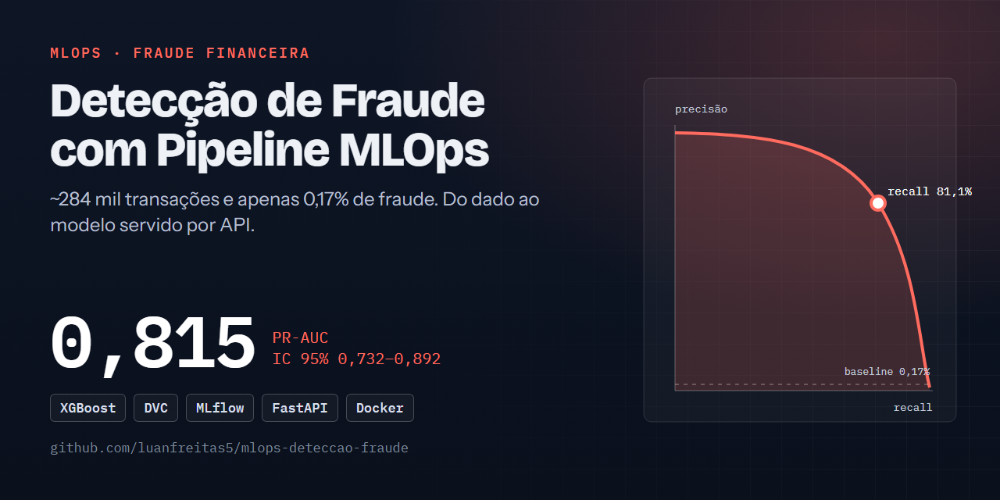
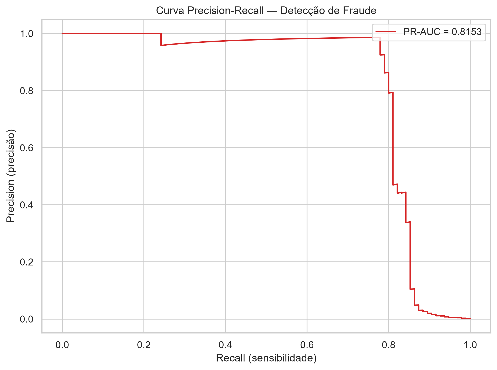
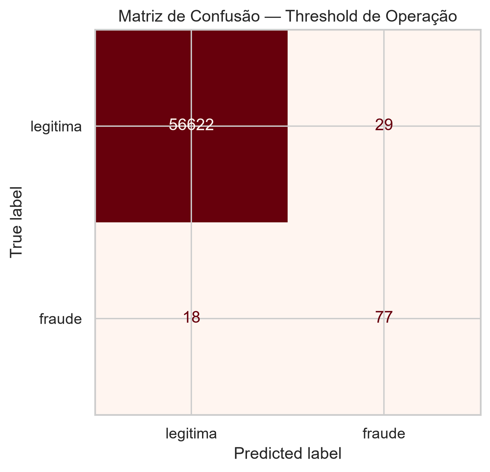

# 🛡️ Detecção de Fraude com Pipeline MLOps: PR-AUC 0,82 com IC 95% em dados com 0,17% de fraudes

[](https://github.com/luanfreitas5/mlops-deteccao-fraude/actions/workflows/ci.yml)
[](https://codecov.io/gh/luanfreitas5/mlops-deteccao-fraude)
[](https://luanfreitas5.github.io/mlops-deteccao-fraude/)
[](LICENSE)
 <!-- = matriz do CI (tests.yml) -->

> **Resultado:** o XGBoost atinge PR-AUC = **0,815 (IC 95%: 0,732–0,892)** no teste (≈ 56,7 mil transações, ≈ 95 fraudes) do dataset *Credit Card Fraud* (ULB), com recall de 0,81 e precisão de 0,73 no limiar escolhido por custo. A comparação com o baseline (Regressão Logística) **ainda não foi medida** — ver [Resultados](#-resultados). O projeto empacota o modelo como sistema: dados em camadas, API, rastreamento de experimentos e CI/CD.



## 🎯 Problema

- **Quem decide o quê:** o time antifraude decide quais transações enviar para revisão humana; o modelo entrega um score de risco e uma decisão limiarizada via API.
- **Custo dos erros:** um falso negativo (fraude não detectada) custa muito mais que um falso positivo (revisão de transação legítima). Hipótese de projeto: **FN = 100 × FP** (`business_cost` em [`configs/config.yaml`](configs/config.yaml)). → **métrica principal: PR-AUC**, porque com 0,17% de positivos a ROC-AUC é otimista; o limiar de decisão minimiza o custo esperado, não é fixado em 0,5.
- **Unidade de predição e momento `t0`:** uma linha por transação; as features usam apenas a própria transação (`V1`–`V28`, `Amount`, `Amount_log`, `Hour`), sem histórico futuro.

## 🗂️ Dados

| Item | Valor |
|---|---|
| Fonte e licença | [Credit Card Fraud (ULB/Kaggle)](https://www.kaggle.com/datasets/mlg-ulb/creditcardfraud) — Database Contents License (DbCL) |
| Tamanho / período | 284.807 transações (283.726 após remover duplicatas), 2 dias de setembro de 2013 |
| Alvo e prevalência | `Class` (1 = fraude), ≈ 0,17% positivos (492 fraudes) |
| Documentação | [Datasheet](reports/datasheets/creditcard.md) |

Os dados seguem a **arquitetura medalhão** (pastas fora do Git, versionadas por DVC):

| Camada | Pasta | Conteúdo |
|---|---|---|
| 🥉 Bronze | `data/bronze/` | CSV como recebido (imutável) + `manifest.json` com o SHA-256 |
| 🥈 Silver | `data/silver/` | `transactions.parquet`: validado (pandera) e deduplicado |
| 🥇 Gold | `data/gold/` | `train/val/test.parquet` (estratificado 60/20/20, semente 42) |

## 📊 Resultados

Protocolo: divisão estratificada 60/20/20 (semente 42); limiar escolhido na **validação** por custo esperado; métricas finais no **teste**, que não participa do ajuste nem do limiar. IC 95% da PR-AUC por bootstrap (1000 reamostragens).

| Modelo | PR-AUC (IC 95%) | ROC-AUC | Recall | Precisão | F1 | Brier |
|---|---|---|---|---|---|---|
| Baseline: Regressão Logística (`class_weight="balanced"`) | *não medido* | — | — | — | — | — |
| **XGBoost** (`scale_pos_weight`) | **0,815 (0,732–0,892)** | 0,968 | 0,811 | 0,726 | 0,766 | 0,0004 |

- **Diferença vs baseline:** não pode ser afirmada — o baseline ainda não foi treinado com o mesmo protocolo e não há teste de significância (McNemar / *t* corrigido). Rodar `make train MODEL=logistic_regression` sobrescreve o modelo salvo, então a comparação pede salvar os artefatos por modelo (pendente).
- **Validação (usada para o limiar):** PR-AUC 0,889 (0,823–0,942), recall 0,894. Os ICs são largos porque há poucas dezenas de fraudes por partição.
- **Limiar de decisão:** 0,0402 (custo esperado na validação = 1028).
- **Pior segmento:** não avaliado — o dataset não tem atributos demográficos (V1–V28 são PCA) e a análise por faixa de `Amount` está pendente (ver [Model Card](reports/model_cards/fraud_xgboost_v0.3.0.md)).

| Curva Precisão–Recall | Matriz de confusão (teste) |
|---|---|
|  |  |

## 🔁 Reproduzir

Requisitos: [uv](https://docs.astral.sh/uv/), `make`, Git e o CSV do dataset em `data/bronze/creditcard.csv` (download manual no Kaggle; fora do Git). O treino registra no MLflow e **recusa árvore Git com alterações não commitadas** (veja `experiment.allow_dirty` em [`configs/config.yaml`](configs/config.yaml)). Tempo de execução: não medido.

```bash
git clone https://github.com/luanfreitas5/mlops-deteccao-fraude.git
cd mlops-deteccao-fraude
# coloque o creditcard.csv em data/bronze/
```

<!-- verify:start -->
```bash
uv sync --locked
make data train evaluate
```
<!-- verify:end -->

Os números de Resultados vêm de [`reports/metrics/test_metrics.json`](reports/metrics/test_metrics.json) (teste) e [`reports/metrics/train_metrics.json`](reports/metrics/train_metrics.json) (validação, limiar e linhagem). Esses arquivos foram gerados em Python 3.14 local, antes da validação cruzada e do MLflow reestruturado; `TODO`: republicar com o `uv.lock` do commit atual e registrar o SHA aqui.

Outros comandos úteis (`make help` lista todos):

| Comando | Descrição |
|---|---|
| `make install` | Instala todos os grupos de dependências e os hooks do pre-commit |
| `make serve` | API de inferência em `http://localhost:8000/docs` |
| `make mlflow` | UI do MLflow (SQLite) em `http://localhost:5000` |
| `make check` | Replica o CI localmente (lint, tipos, segurança, qualidade, testes ≥ 80%) |
| `make docker-up` | API + MLflow + Postgres via Docker Compose (o modelo é montado, não embutido) |
| `make reproduce` | Reexecuta só os estágios afetados do pipeline (DVC) |

## 🧱 Estrutura

```text
├── app/               # API FastAPI (/health, /predict) com validação de schema
├── configs/           # YAML validados por Pydantic (config, paths, logging, modelo, deploy)
├── data/              # bronze / silver / gold (fora do Git; DVC)
├── docker/            # Dockerfile do servidor MLflow
├── notebooks/         # EDA (exploração; sem lógica de produção)
├── reports/           # métricas (JSON), figuras, Model Card e Datasheet
├── src/               # código por funcionalidade: data, features, training, evaluation, inference, experiment...
└── tests/             # unitários, property-based, comportamentais e de API
```

Decisões que justificam as ferramentas: **pandera** valida o contrato em cada fronteira (bronze→silver→gold e requisições da API) para falhar cedo; **MLflow com SQLite** registra cada run com `git_sha`, `data_hash` e `seed`, um run filho por fold e o modelo com assinatura; **uma única função** (`prepare_xy`) gera as features no treino e no serving, evitando *train-serve skew*; **SMOTE**, quando usado, fica dentro de um `imblearn.Pipeline` e só atua no ajuste.

## ⚠️ Limitações

- Apenas 2 dias de dados de 2013 e só cartões europeus: **sem validação externa nem temporal**; a divisão é aleatória, o que tende a ser otimista frente a um cenário prospectivo.
- ≈ 95 fraudes no teste: o IC da PR-AUC é largo (0,73–0,89); diferenças menores que isso não são conclusivas.
- Baseline, teste de significância, análise por fatias e curva de calibração **pendentes** (listados como `TODO` no Model Card).
- As features são PCA anonimizadas: sem auditoria de fairness e com interpretabilidade limitada.
- Os custos FN/FP são hipóteses de projeto; o limiar deve ser recalibrado com custos reais.
- Sem monitoramento de deriva implantado (plano descrito no Model Card).

## 📄 Licença e citação

MIT — ver [LICENSE](LICENSE). Documentação completa (guias e API gerada das docstrings): [site MkDocs](https://luanfreitas5.github.io/mlops-deteccao-fraude/).
